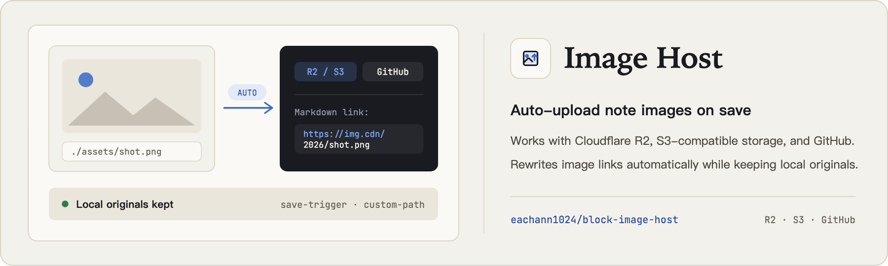

<picture>
  <source media="(prefers-color-scheme: dark)" srcset="assets/card-en-dark.png">
  <source media="(prefers-color-scheme: light)" srcset="assets/card-en-light.png">
  
</picture>

Broken images are frustrating when publishing to a blog or opening your notes on another computer. Think of Image Host as PicGo built right into Block: it automatically uploads local images to your own cloud storage and replaces local paths with live URLs, while leaving your original files intact.

- **Works with popular cloud storage**: Connect GitHub, Cloudflare R2, AWS S3, and other S3-compatible storage providers using your own account.
- **Upload on save, originals stay safe**: Paste screenshots or insert local images as usual: when you save, Image Host uploads them and updates your Markdown links automatically without ever deleting local originals.
- **Menu bar quick upload and history**: Drag images onto the menu bar icon or click to upload from your clipboard; the live link is copied right away, with recent uploads ready to reuse anytime.
- **Custom paths and upload filters**: Customize remote folder paths, file naming rules, and filters to decide exactly which images get uploaded.

**Install**: Open Block Settings -> App Store and search **Image Host**, or enter `blockmd-plugins/block-image-host`.
