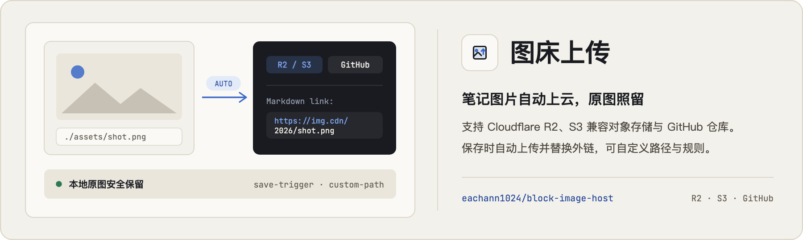

<picture>
  <source media="(prefers-color-scheme: dark)" srcset="assets/card-zh-dark.png">
  <source media="(prefers-color-scheme: light)" srcset="assets/card-zh-light.png">
  
</picture>

写完文章准备发博客、发公众号，或者换台电脑打开笔记，最怕图片路径失效变裂图。这款插件就像内置在笔记里的 PicGo，写笔记时自动把本地图片传到你自己的云端空间并换成在线链接，本地原图还会好好留着。

- **主流云存储随心连**：支持免费好用的 GitHub、Cloudflare R2，以及阿里云 OSS、AWS S3 等常见 S3 兼容云存储，不用受限于第三方公共图床。
- **保存就自动换链，不删原图**：本地拖图、截图写完一保存，插件就自动上传并把笔记里的本地路径替换成在线外链，本地原图始终保留不删除。
- **菜单栏随手一拖就传**：也可以直接把图片拖到顶部菜单栏图标上，或点一下上传剪贴板里的截图，上传完自动把链接复制到剪贴板，随时查看和复用最近上传记录。
- **存放路径和筛选都能自己定**：支持自定义云端文件夹和图片命名规则，也能按条件筛选要上传的图片范围，整理图库更清晰。

**安装**：打开 Block「设置 → 应用商店」搜索 **图床上传**，或手动填入 `blockmd-plugins/block-image-host`。
